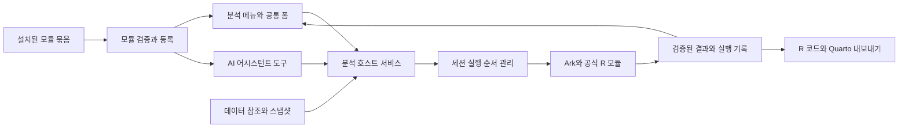
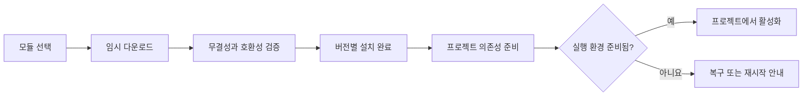

# R Sage 분석 모듈 구조와 Descriptives 구현 전략

_2026-10-17 · 기술 검토 및 구현 제안 · 검토한 코드 기준: `1894c4b`, 개정 검토 기준: `f0dacd3` (PR #16까지)_

이 문서는 JASP처럼 필요한 분석 기능을 모듈 단위로 설치·활성화하는 R Sage의 확장 구조를 제안한다. 사용자가 제공한 두 화면은 메뉴 구성과 모듈 관리 경험의 참고 자료로 사용했다. **현재 단계는 설계**이며, 모듈 구현·설정 변경·패키지 설치는 수행하지 않았다. 아래 파일 구조, API, 버전 값은 구현을 위한 제안이며 현재 제공되는 기능이 아니다. 모듈 목록과 R 패키지 선정 기준은 [analysis-modules-catalog.md](analysis-modules-catalog.md)에 있다.

> **개정 요약 (2026-10-17, 구현 계획 7단계와 대조 후)**
>
> 1. **AI 어시스턴트 경로 추가.** R Sage의 핵심은 AI 어시스턴트이므로, 모든 분석은 GUI와 같은 계약으로 어시스턴트 도구로도 노출한다. ([🤖 AI 어시스턴트 연동](#-ai-어시스턴트-연동))
> 2. **실행 조정 계층 축소.** Ark가 shell 요청을 순서대로 처리하므로, 스냅샷과 분석 호출을 한 요청으로 묶고 P0에서는 소유권 있는 interrupt와 revision 게시만 구현한다.
> 3. **보고서 삽입 기본값 변경.** 기본은 qmd의 기존 데이터 준비 청크 뒤에 같은 R 함수를 호출하는 청크를 넣는 것이고, RDS 스냅샷 묶음은 재현 패키지 내보내기용이다. 결과 출력용 `knit_print` 메서드를 추가한다.
> 4. **공통 R 런타임 패키지 `rsage` 도입.** 결과 헬퍼·JSON 기록·`knit_print`를 모듈마다 반복하지 않는다.
> 5. **R 라이브러리 정책 단순화.** 첫 버전은 프로젝트 전용 라이브러리를 새로 만들지 않고 기존 패키지 패널·Quarto와 같은 `.libPaths()`를 쓰며, 버전은 `modules.lock.json`에 기록한다.
> 6. 일반 플러그인 플랫폼(별도 플러그인 호스트, 임의 UI)은 분석 모듈과 분리해 후속 단계로 둔다. 구현 계획의 7단계도 7a(분석 모듈)·7b(일반 플러그인)로 나눴다.
> 7. **tidyverse와 easystats를 모든 분석의 공통 중간 단계로 정한다.** 데이터 준비는 dplyr·tidyr, 그림은 ggplot2, 모델 결과·효과크기·진단은 easystats로 정리한다. 이에 따라 Descriptives의 그림도 base graphics 대신 ggplot2로 바꿨다. ([공통 중간 단계](#공통-중간-단계-tidyverse와-easystats))

---

## 🎯 결론과 권장 방향

**기술적으로 가능하다.** R Sage에는 이미 Electrobun/React 화면, 호스트 RPC, Ark 기반 R 세션, 실행 이력, 데이터 뷰어, 패키지 관리, Quarto 실행 경로가 있다. 이를 연결할 분석 모듈 계층을 추가하면 된다. 다만 현재 코드만으로 외부 모듈을 설치하거나 GUI 분석을 저장·복원할 수 있는 것은 아니다.

권장하는 기본 단위는 다음과 같다.

> 분석 모듈 = 모듈 설명 + 분석 목록 + 입력 화면 정의 + R 계산 패키지 + 결과 규격 + 도움말 + AI 도구 설명 + 호환성·마이그레이션 정보

GUI와 AI 어시스턴트는 같은 분석의 두 입구다. 사용자가 폼에서 실행하든 어시스턴트가 도구로 실행하든 같은 옵션 스키마로 검증하고, 같은 R 함수가 계산하고, 같은 분석 인스턴스로 저장한다. 어시스턴트가 만든 분석도 사용자가 분석 탭에서 열어 옵션을 고칠 수 있어야 한다.

예를 들어 `Descriptives` 모듈 안에 `기술통계`, 이후 `분포 탐색`, `교차표` 등의 분석을 둘 수 있다. 화면에서 만든 “연령과 점수의 그룹별 기술통계”는 그 모듈을 사용한 개별 **분석 인스턴스**다. R의 `ggplot2` 같은 패키지는 모듈 자체가 아니라 모듈이 필요로 하는 계산·시각화 의존성이다.

추진 순서는 다음과 같다.

1. 최소 공통 규격과 호스트 실행 계층을 만들고, 공식 Descriptives를 GUI와 어시스턴트 도구 양쪽에서 동작하는 첫 구현으로 완성한다.
2. 같은 Descriptives를 외부 모듈 파일로 설치하여 **앱 재빌드 없이** 발견·실행·저장할 수 있는지 검증한다.
3. 공식 모듈 카탈로그, 버전 고정, 업데이트·복구를 추가한다.
4. 두 번째 실제 분석 모듈에서 규격의 범용성을 검증한 뒤 커뮤니티 배포 범위를 결정한다.

처음부터 범용 IDE 플러그인 플랫폼이나 공개 마켓플레이스 전체를 만들 필요는 없다. 반대로 Descriptives 화면만 앱에 고정해서 만드는 것도 부족하다. 첫 모듈부터 외부 모듈과 동일한 계약을 사용해야 한다.

## 🔍 검토 근거와 현재 코드의 연결 지점

### JASP에서 가져올 원리

JASP 공식 개발 문서의 모듈은 R 패키지 구조에 `Description.qml`, 분석별 QML 화면, 도움말·아이콘 등을 더한 형태다. 메뉴와 분석 함수의 연결, 의존성, 저장된 옵션의 업그레이드를 모듈 단위로 다룬다.[^1] 모듈 라이브러리는 별도 카탈로그에서 검색·필터링·설치를 지원한다.[^2]

R Sage에서는 이 역할 구분을 채택하되, 화면은 기존 React와 선언형 폼 규격으로 구현하는 것이 적합하다. **JASP 모듈 파일을 그대로 설치하는 호환성은 목표에서 제외한다.** QML 화면과 JASP 전용 결과·실행 계층을 R Sage가 제공하지 않기 때문이다. 실제 `jaspDescriptives`에도 `jaspBase`, `jaspGraphs`, `jaspTTests` 등 전용 의존성이 있다.[^3]

JASP의 Descriptives 전체에는 raincloud, 시계열, flexplot, plot builder까지 포함된다.[^4] R Sage 첫 버전은 기본 기술통계와 빈도표·기본 그래프에 집중한다. JASP 소스나 아이콘을 복사하는 방식은 채택하지 않는다. 참고 저장소의 라이선스 표기는 `GPL (>= 2)`이며, 소스 재사용은 별도의 라이선스 검토 사항이다.[^3]

### 현재 소스에서 확인한 기반

아래는 소스 확인 결과다. 이번 작업에서 앱 실행이나 모듈 시제품 검증을 수행했다는 뜻은 아니다. 기존 README와 구조 문서의 진행 상황 일부는 최신 소스보다 오래되어, 구현 여부는 실제 파일을 기준으로 판단했다.

| 기반 | 확인한 소스 | 모듈 구현 시 활용·보완 |
| --- | --- | --- |
| 데스크톱과 UI 연결 | [desktop entry](../apps/desktop/src/bun/index.ts) | 기존 `wire` RPC 사용; 셸 교체 불필요 |
| 기능 호출의 중심 | [Host](../packages/host/src/host.ts) | `modules.*`, `analyses.*`, `datasets.*` 추가 |
| 공유 계약 | [shared](../packages/shared/src/index.ts) | 모듈·분석·결과 타입과 런타임 검증 추가 |
| R 실행과 세션 세대 | [KernelSession](../packages/kernel/src/session.ts) | 실행 ID·완료 이벤트 활용; 작업 소유권·취소 제어 보완 |
| 출력 수집 | [collectExecution](../packages/host/src/execute.ts) | 이력 연결 재사용; 표를 콘솔 문자열에서 파싱하지 않음 |
| 데이터 탐색 | [DataViewerPanel](../packages/ui/src/components/DataViewerPanel.tsx) | 열·행 정보 참고; 분석용 데이터 참조 계층은 별도 필요 |
| 패키지 관리 | [host packages](../packages/host/src/packages.ts), [UI packages](../packages/ui/src/packages.ts) | 설치 진행·오류 UX 재사용; 모듈 의존성 해결은 호스트로 추가 |
| 패널·명령 | [Workbench](../packages/ui/src/components/Workbench.tsx), [commands](../packages/ui/src/commands.ts) | 분석 패널, 메뉴, 명령 팔레트 등록 |
| 저장 위치 | [Project](../packages/host/src/project.ts), [Config](../packages/host/src/config.ts) | 프로젝트 `.rsage/`와 앱 `appDir()` 관례 유지 |
| 보고서 실행 | [QuartoService](../packages/host/src/quarto.ts) | 별도 R 프로세스에서 실행 가능한 분석 내보내기 연결 |
| AI 어시스턴트 도구 | [tools](../packages/host/src/assistant/tools.ts), [MCP 서버](../packages/host/src/assistant/mcp.ts) | 현재 9개 도구가 고정 배열(`TOOL_SPECS`)이다. 모듈 분석을 도구로 노출하려면 동적 등록이 필요 |
| 데이터 변경 코드 | [DataViewerPanel](../packages/ui/src/components/DataViewerPanel.tsx), [R 코드 생성](../packages/ui/src/dataviewer/rcode.ts) | PR #16 이후 형 변환·factor·이름 변경은 콘솔 R 코드로 실행되고, 정렬·필터는 Convert to Code를 눌렀을 때만 코드가 됨. 분석 입력은 R 객체를 참조하므로 화면 정렬·필터로는 바뀌지 않음 |

현재 `Host.dispatch()`는 메서드 선택 후 매개변수를 전달하는 구조다. TypeScript 타입은 외부 JSON의 유효성이나 권한을 검증하지 않는다. 설치 파일, 폼 설정, 분석 요청, 결과 파일에는 **호스트 측 런타임 검증**이 필요하다. 현재 데이터 뷰어의 `commId`도 세션 재시작 후 계속 사용할 데이터 식별자가 아니다.

## 🧩 모듈 계약과 권장 아키텍처

### 선택한 방식과 대안

| 방식 | 장점 | 비용·제약 | 판단 |
| --- | --- | --- | --- |
| 앱에 분석별 React 화면 고정 | 첫 화면을 빠르게 제작 | 새 분석마다 앱 수정·배포 | 공통 UI 부품에만 사용 |
| 선언형 폼 + R 패키지 | 일관된 UI, 설치 가능, 검증 용이 | 복잡한 상호작용 표현에 한계 | 기본 규격으로 채택 |
| 임의 React/JS 플러그인 | 자유로운 화면 | 권한·의존성·업데이트 부담 | 필요성이 입증되면 별도 설계 |
| JASP 모듈 직접 호환 | 기존 모듈 활용 가능성 | QML·전용 런타임 이식 필요 | 초기 범위에서 제외 |
| Shiny 앱을 모듈로 실행 | 기존 R 웹앱 활용 가능성 | 별도 서버·세션·결과 저장 통합 필요 | 독립 앱 연동 후보로 유보 |

초기 설치 모듈에는 임의 JavaScript를 넣지 않는다. 호스트가 검증한 JSON을 기존 React 컴포넌트가 렌더링한다. JSON Schema는 입력 자료형·필수값 검증에 사용하고, 화면 배치는 별도 UI 정의로 다룬다. 조건부 표시도 `equals`, `in`, `and` 같은 제한된 연산만 지원하며 문자열 `eval`을 사용하지 않는다.

Electrobun 공식 문서도 Bun 호스트와 WebView의 typed RPC 구분을 제공한다. 외부 콘텐츠에 권한 있는 RPC를 연결하지 않는 원칙을 유지한다.[^5] 현재 저장소의 Electrobun 의존성은 `2.0.2`다. 최신 문서의 API 예제를 그대로 복사하지 않고 구현 시 이 버전과 맞춰 확인해야 한다.



### 최소 구성 요소

| 구성 요소 | 책임 |
| --- | --- |
| `ModuleRegistry` | 설치 버전 발견, 호환성 확인, 활성화 상태, 메뉴 정의 제공 |
| `ModuleInstaller` | 묶음 검증, 임시 설치, 의존성 준비, 완료·실패·복구 |
| `AnalysisService` | 분석 생성·수정·실행·복제·삭제, 상태 저장, 결과 교체 |
| `DatasetService` | R 객체 등록, 스키마·측정수준, 선택 열 스냅샷, 변경 확인 |
| `AnalysisRunner` | 분석 실행을 Ark 요청 하나로 만들고, 자기 소유 실행만 취소, 최신 revision만 게시 (P0 범위) |
| `AnalysisForm` | 변수 선택, 그룹 선택, 옵션, 검증 오류 표시 |
| `ResultRenderer` | 표·그림·주석·경고를 공통 규격으로 표시 |
| `AnalysisExporter` | 동일 계산 경로의 R 코드, 데이터, 환경 정보, 보고서 묶음 생성 |
| `AnalysisTools` | 활성 모듈의 분석을 어시스턴트 도구로 등록하고, 도구 호출을 `AnalysisService`로 넘김 |
| `rsage` R 패키지 | 모든 모듈이 공유하는 R 런타임: 결과 헬퍼(`rs_table()`, `rs_plot()`, `rs_note()`), `result.json` 기록, `knit_print` 메서드 |

콘솔·에디터·AI의 모든 실행을 감싸는 범용 `ExecutionCoordinator`는 처음부터 만들지 않는다. 필요성은 P0 이후 측정 결과로 판단한다. 근거는 [R 실행 설계](#초기에는-공식-모듈과-공유-r-세션)에 있다.

`modules.*`는 앱의 신뢰된 화면이 호출하는 API다. 설치된 R 모듈에 `Host.dispatch()` 전체를 넘겨주지 않는다. R 함수에는 분석 데이터, 검증된 옵션, 해당 실행의 결과 디렉터리만 인자로 전달한다. 이 인자 제한이 R 코드 자체의 파일·네트워크 접근을 차단하는 보안 장치는 아니라는 점은 뒤에서 별도로 다룬다.

### 모듈 파일과 manifest 예시

배포 단위는 예를 들어 `.rsagemodule` 확장자의 ZIP 묶음으로 정할 수 있다. 내부 R 패키지는 표준 패키지로 유지해 GUI 밖에서도 사용할 수 있게 한다. 다음 이름·값은 제안이다.

```text
descriptives.rsagemodule
  manifest.json
  schemas/descriptives.options.json
  forms/descriptives.ui.json
  packages/rsageDescriptives_0.1.0.tar.gz
  ai/descriptives.md
  help/ko/descriptives.md
  help/en/descriptives.md
  icons/descriptives.svg
  checksums.json
  LICENSE
```

```json
{
  "manifestVersion": 1,
  "id": "org.rsage.descriptives",
  "version": "0.1.0",
  "title": "Descriptives",
  "publisherId": "org.rsage",
  "moduleApi": ">=0.1.0 <0.2.0",
  "runtime": {
    "kind": "r-package",
    "package": "rsageDescriptives",
    "packageVersion": "0.1.0",
    "artifact": "packages/rsageDescriptives_0.1.0.tar.gz",
    "rVersion": ">=4.2.0",
    "rsageRuntime": ">=0.1.0 <0.2.0",
    "execution": "shared-session"
  },
  "analyses": [
    {
      "id": "descriptives",
      "title": "기술통계",
      "entrypoint": "analyse",
      "optionsSchema": "schemas/descriptives.options.json",
      "optionsSchemaVersion": 1,
      "ui": "forms/descriptives.ui.json",
      "resultSchemaVersion": 1,
      "requiresDataset": true,
      "assistant": {
        "tool": "descriptives",
        "summary": "Descriptive statistics, frequency tables and basic plots for chosen variables, optionally split by one group variable.",
        "guide": "ai/descriptives.md"
      }
    }
  ]
}
```

`publisherId`는 자기신고 값만으로 신뢰하지 않는다. 공식 표시는 검증된 배포 서명·카탈로그의 발행자와 일치할 때 호스트가 부여한다. `shared-session`도 요청일 뿐이며 실제 허용 여부는 호스트 정책이 결정한다. 최소 R 버전 예시는 현재 앱 기준을 출발점으로 삼은 것으로, 모듈의 지원 범위는 실제 R 버전별 검사 후 확정한다.

필수 구분은 `manifestVersion`(포장 형식), `moduleApi`(호스트 계약), `version`(모듈 릴리스), `optionsSchemaVersion`(저장 옵션), `resultSchemaVersion`(결과 형식)이다. 호환되지 않는 형식은 실행을 차단하고 설명한다. 안정 버전 전에는 호스트 계약을 좁게 지원하고, 두 번째 모듈 검증 후 1.0 계약을 정한다.

`assistant`는 이 분석을 AI 어시스턴트 도구로 노출할 때 쓰는 이름과 설명이다. 도구 입력 스키마는 따로 적지 않고 `optionsSchema`에서 만든다. `ai/*.md`는 어시스턴트에게 줄 사용 지침(언제 쓰는지, 측정수준 주의, 결과 해석 범위)이며 사용자 도움말과 분리한다. 생략하면 GUI 전용 분석이 되며, 공식 모듈은 생략하지 않는다.

R 패키지의 전이 의존성은 `DESCRIPTION`을 원천으로 해결한다. 카탈로그에 보여주는 의존성 요약과 패키지 내용이 일치하는지 확인하고, 실제 해결된 버전·출처는 프로젝트 잠금 파일에 기록한다. 초기 Descriptives는 공통 중간 단계(아래)를 따라 `dplyr`·`tidyr`로 데이터를 정리하고, `stats`로 계산하고, `ggplot2`로 그린다. JSON 입출력용 `jsonlite`는 런타임의 명시적 의존성으로 준비하며, 추가 설치가 전혀 없다고 표현하지 않는다.

모든 모듈 R 패키지는 공통 런타임 패키지 `rsage`에 의존한다(`rsageRuntime`이 호환 범위). `rsage`는 JASP의 `jaspBase`에 해당하지만 훨씬 작게 유지한다. 결과 객체 생성 헬퍼(`rs_table()`, `rs_plot()`, `rs_note()`), 결과 규격에 맞는 `result.json` 기록, 그리고 Quarto·knitr에서 같은 결과 객체를 표와 그림으로 출력하는 `knit_print` 메서드를 제공한다. 모듈 패키지는 계산만 담당하고 결과 형식·직렬화는 `rsage`에 맡긴다. 앱은 `rsage`를 번들해 설치하며, 계획서 0단계에 있던 앱 전용 R 패키지 `r/rsage`가 이것이다.

### 공통 중간 단계: tidyverse와 easystats

모든 분석 모듈은 같은 중간 단계를 거친다. 모듈마다 데이터 정리·결과 정리·그림 방식이 달라지면 결과 형식이 흩어지고, AI 어시스턴트와 보고서 청크가 모듈마다 다른 코드를 읽게 된다.

| 단계 | 기본 패키지 | 쓰임 |
| --- | --- | --- |
| 입력 정리 | `dplyr`, `tidyr`, `tibble` | 변수 선택, 결측·그룹 처리, 긴 형식 변환. 입력은 tibble로 맞춤 |
| 계산 | 모듈별 백엔드 | `stats`, `lme4`, `lavaan` 등 ([모듈 목록](analysis-modules-catalog.md)) |
| 결과 정리 | `parameters`, `effectsize`, `performance`, `datawizard`, `insight` | 계수·신뢰구간·효과크기·적합도·가정 진단을 같은 형식의 표로 |
| 그림 | `ggplot2` | 모든 결과 그림. 그림 객체를 `rs_plot()`이 파일로 저장 |
| 결과 객체 | `rsage` | 위 결과를 `rs_table()`·`rs_plot()`으로 묶어 `result.json`과 `knit_print`로 출력 |

모듈 R 패키지는 `tidyverse`·`easystats` 메타 패키지가 아니라 실제로 쓰는 구성 패키지만 `Imports`에 적는다. 메타 패키지는 설치 부담이 크고, 쓰지 않는 패키지까지 버전 잠금에 들어온다. 보고서 청크로 내보낸 코드도 이 구성 패키지만 `library()`로 부른다.

이 단계 덕분에 보고서 삽입 코드가 사람이 읽을 수 있는 tidyverse 코드가 된다. 사용자가 분석 청크를 열었을 때 `df |> dplyr::select(...) |> rsageDescriptives::analyse(...)`처럼 익숙한 형태로 보인다.

### 분석 요청과 결과 규격

호스트 API의 최소 범위는 다음과 같다. 장시간 작업은 즉시 `jobId`/`runId`를 돌려주고 이벤트로 진행 상황을 전달한다.

| API 그룹 | 제안 메서드 |
| --- | --- |
| 모듈 | `modules.list`, `modules.inspect`, `modules.install`, `modules.enable`, `modules.disable`, `modules.remove` |
| 데이터 | `datasets.list`, `datasets.inspect`, `datasets.snapshot`, `datasets.rebind` |
| 분석 | `analyses.create`, `analyses.update`, `analyses.run`, `analyses.cancel`, `analyses.get`, `analyses.list`, `analyses.export` |
| 이벤트 | `modules.jobChanged`, `analyses.changed`, `analyses.runChanged` |

분석 정의에는 `analysisId`, 모듈 ID·정확한 버전, 분석 종류, 옵션 버전, `optionsRevision`, 데이터 바인딩, 측정수준, 옵션을 저장한다. 실행 기록에는 별도의 `runId`, 요청 revision, `executionId`, 세션 generation, 스냅샷 hash, 환경·코드 hash, 시작·종료 시각, 상태를 기록한다. 분석은 수정 가능하고, 완료한 실행 기록은 불변으로 유지한다.

결과는 HTML 덩어리나 콘솔 출력 문자열이 아닌 다음 구조로 받는다.

- `tables`: 열 ID·자료형·행 값·분모·단위·주석. 원래 숫자를 보존하고 화면에서만 반올림한다.
- `plots`: 저장된 그림의 상대 경로, MIME, 크기, 설명, 해당 그림의 계산·표본 정보.
- `notes`와 `warnings`: 안정된 코드, 메시지, 관련 변수 ID. 오류와 통계적 주의를 구분한다.
- `provenance`: 모듈·R·패키지 버전, 데이터·옵션·코드 식별자, 실행 시각.

JSON에는 `NaN`/`Inf`를 넣지 않는다. 계산 불가 값은 `null`과 `insufficient_n`, `no_valid_values` 같은 사유 코드로 표현한다. 큰 표는 호스트가 저장하고 UI에서 페이지 단위로 가져온다. 모듈의 도움말·문자열은 이스케이프하고, 임의 HTML·스크립트는 공통 결과 규격에서 제외한다.

### 그림 크기 규칙 (모든 모듈)

그림은 인치 단위 크기로 R에서 그린다. 글자 크기는 포인트로 고정되므로, 같은 그림이라도 캔버스가 작으면 패널이 줄고 글자가 겹친다. 그래서 그림 크기는 화면에서 늘이거나 줄여 맞추지 않고, R이 그릴 때부터 그림의 내용에 맞춘다. 2026-10-17 결측 모듈에서 31개 그룹 그림이 찌그러진 원인이 이것이었다. 모듈이 7×4.5인치로 고정해 그렸기 때문이다. 같은 그림이 qmd 청크에서 제대로 보인 것은 더 큰 장치에서 그려졌기 때문이다.

1. **모듈은 숫자를 직접 쓰지 않고 내용을 알린다.** `rsage::rs_figure_size(panels, x_items, y_items, label_chars, aspect, legend)`에 패널 수, 축의 범주 수, 가장 긴 라벨 길이를 넘긴다. 이 함수가 너비·높이(인치)와 패널 배치(`ncol`, `nrow`)를 정한다. 결과는 `rs_plot(..., size = )`로 전달한다. 너비는 12인치, 높이는 10인치가 기본 상한이다.
2. **한계를 넘으면 배치를 바꾼다.** 패널이 1.6인치보다 좁아져야 하거나 상한을 15% 넘게 초과하면 `compact = TRUE`를 돌려준다. 그러면 모듈은 더 조밀한 형태로 바꾼다. 예를 들면 소형 다중 그림 대신 히트맵, 축 뒤집기, 라벨 줄이기다. 결측 모듈은 그룹이 48개 이하이고 화면에 들어가면 그룹별 그림을 그리고, 그보다 많으면 변수×그룹 히트맵을 그린다.
3. **사용자가 크기를 정할 수 있다.** 분석 탭의 각 그림에는 다음 도구가 있다.
   - 크기: 자동(모듈이 정한 크기), 비율(16:9, 4:3, 정사각, 3:4), 크게·작게, 직접 입력
   - 보기: 실제 크기 / 탭 너비에 맞춤
   - 플롯 창에서 열기: `rsage::rs_show_plot()`으로 세션에서 다시 그린다. 그러면 플롯 창의 창 맞춤·비율 도구와 Save Plot(PNG·SVG·PDF 등)을 그대로 쓸 수 있다.

   사용자가 정한 크기는 분석의 `figures`에 저장된다. 실행할 때 `rsage::rs_resize()`가 이 크기를 적용해 그림을 다시 그린다. 모듈 코드는 이 과정에 관여하지 않는다.
4. **문서에서도 같은 크기로 그린다.** "R 코드"와 "문서에 넣기"가 만드는 코드에는 `rsage::rs_resize(res, list(<그림 id> = c(너비, 높이)))`가 들어간다. `knit_print`는 각 그림을 그 크기로 저장하므로, Quarto 출력이 분석 탭과 같다. 청크의 `fig-width`·`fig-height`는 그림마다 크기가 다른 결과에 맞지 않아 쓰지 않는다.
5. 결과 JSON의 각 그림에는 현재 크기(`width`, `height`)와 자동 크기(`autoWidth`, `autoHeight`)를 함께 기록한다. 그림을 플롯 창에서 다시 그릴 수 있도록 `plot-<id>.rds`도 저장한다.

## 🤖 AI 어시스턴트 연동

R Sage에서 사용자는 주로 AI 어시스턴트나 분석 GUI로 분석한다. 따라서 분석 모듈은 GUI보다 먼저, 또는 최소한 동시에 어시스턴트가 쓸 수 있어야 한다. 어시스턴트가 `run_r`로 임의 코드를 써서 같은 계산을 다시 구현하면, 결과가 모듈 규격(결측 처리, 분모, 측정수준)과 달라지고 GUI에서 고칠 수도 없다.

### 현재 코드와 필요한 변경

현재 어시스턴트 도구는 [tools.ts](../packages/host/src/assistant/tools.ts)의 고정 배열 `TOOL_SPECS`(9개)이고, Claude·Codex 모두 [MCP 서버](../packages/host/src/assistant/mcp.ts)를 통해 같은 목록을 받는다. 모듈 도구를 붙이려면 다음이 필요하다.

1. `TOOL_SPECS`를 정적 기본 도구와 동적 등록 도구로 나눈다. `ModuleRegistry`가 프로젝트에서 활성화된 모듈이 바뀔 때마다 도구 목록을 갱신하고, MCP 서버는 `tools/list`에서 현재 목록을 돌려준다(필요하면 `notifications/tools/list_changed`).
2. 도구 수가 모듈 수에 비례해 늘지 않도록 공통 도구 세 개로 시작한다.
   - `list_analyses`: 활성 모듈의 분석 목록, 각 분석의 `assistant.summary`.
   - `describe_analysis(analysis)`: 옵션 JSON Schema와 `ai/*.md` 지침.
   - `run_analysis(analysis, dataset, options, title?)`: 분석 인스턴스를 만들고 실행해 `analysisId`, `runId`, 결과 요약을 돌려준다.
   - `get_analysis_result(analysisId)`: 저장된 결과 표를 수치 그대로 돌려준다.
   분석이 많아져 모델이 목록을 놓치는지 평가한 뒤에만 분석별 전용 도구(`assistant.tool`)를 추가로 노출한다.
3. 옵션 검증은 GUI와 같은 호스트 런타임 검증을 쓴다. 검증 오류는 어시스턴트가 고칠 수 있게 필드 경로와 이유를 담아 돌려준다.
4. `run_analysis`로 만든 분석은 GUI와 같은 `<project>/.rsage/analyses/`에 저장하고, 채팅의 도구 행에서 “분석 탭에서 열기”로 이어진다. 사용자가 탭에서 옵션을 바꾸면 새 revision이 되고 어시스턴트는 `get_analysis_result`로 최신 결과를 읽는다.
5. 원본 데이터를 바꾸지 않는 분석 실행은 `run_r`처럼 매번 승인받지 않아도 된다. 다만 모듈 설치·활성화, 의존성 설치는 계획서 6b의 `manage_packages`(아직 미구현)와 같이 항상 승인을 받는다. 승인 범위는 기존 3단계 편집 승인(PR #9) 설정에 “분석 실행” 항목을 추가한다.

### 보고서 작성과 수치 출처

어시스턴트가 qmd 보고서를 쓸 때 분석 결과를 손으로 옮겨 적지 않는다. [코드와 Quarto 내보내기](#코드와-quarto-내보내기)의 분석 청크를 삽입하고, 본문 수치는 그 청크가 만든 결과 객체에서 인라인 R 코드로 읽는다(예: `` `r rsage::rs_value(desc, "age", "mean")` ``). 결과 JSON의 `provenance`는 구현 계획 6c의 수치 출처 규칙(실행 ID 기록)에 그대로 쓴다. 해석 문장은 결과 표에 있는 값과 `notes`/`warnings` 범위 안에서만 쓰도록 `ai/*.md` 지침에 적는다.

### 검증

평가 세트에 “이 데이터의 기술통계를 그룹별로 보여줘” 같은 요청을 넣고, 어시스턴트가 `run_r` 대신 `run_analysis`를 고르는지, 측정수준 오류를 스스로 고치는지, 결과 수치가 GUI 실행과 같은지 확인한다.

## ⚙️ R 실행·데이터·재현성 설계

### 초기에는 공식 모듈과 공유 R 세션

기존 콘솔에서 만든 `df`를 그대로 선택할 수 있게 **공식 모듈의 첫 실행 경로는 현재 Ark 세션**으로 한다. 다만 계산에 넘기는 것은 실행 시 고정한 입력이며, 함수는 `analyse(data, options, context)` 같은 명시적 인자로 동작하도록 한다. 전역 변수 이름에 몰래 의존하거나 원본 데이터를 수정해서는 안 된다.

현재 `KernelSession.execute()`는 요청을 바로 커널에 전송하고, `interrupt()`는 실행 중인 세션 작업을 중단한다. 따라서 모듈 요청에 debounce만 붙여서는 안전한 실행 취소가 되지 않는다. 반면 Ark는 shell 채널의 `execute_request`를 받은 순서대로 하나씩 처리하므로, 요청 **사이**의 순서는 이미 보장된다. 이 점을 이용해 범용 조정 계층 없이 다음 규칙만 `AnalysisRunner`에 둔다.

1. **스냅샷과 계산을 한 요청으로 묶는다.** 선택 열 스냅샷 저장, `analyse()` 호출, `result.json` 기록을 하나의 `execute_request`(silent, 이력 미저장)로 보낸다. 한 요청 안에서는 다른 콘솔·AI 코드가 끼어들 수 없으므로, 스냅샷과 계산 사이의 쓰기 경쟁을 따로 막을 필요가 없다.
2. 아직 보내지 않은 요청은 `AnalysisRunner` 안에서만 대기시키고, 같은 분석의 연속 변경은 최신 revision으로 합친다. 콘솔·에디터·AI 실행 경로는 바꾸지 않는다.
3. 실행 취소는 `KernelSession.runningExecution()`이 해당 분석 소유일 때만 interrupt한다. 이미 Ark 큐에 들어갔지만 아직 시작하지 않은 요청은 interrupt하지 않고, 끝난 뒤 결과를 버린다.
4. 결과는 `analysisId + runId + optionsRevision + datasetSnapshotId + generation`이 현재 요청과 맞을 때만 화면의 최신 결과로 게시한다. 늦은 응답은 기록으로만 남긴다.
5. 재시작·커널 종료·프로젝트 전환 시 대기 작업을 무효화하고 실행 중 작업을 aborted로 마감한다. 기존 `ExecutionRecord`의 세션 generation과 aborted 처리를 재사용한다. 타임아웃은 실패 상태를 만들되, 커널이 실제로 멈췄는지 확인하기 전 다음 계산을 밀어 넣지 않는다.

콘솔에서 긴 계산이 도는 동안 분석 결과가 늦게 나오는 것은 공유 세션의 정상 동작으로 받아들이고, 분석 탭에 “R이 다른 작업 중” 상태를 표시한다. P0 측정에서 이 대기가 문제가 될 때만 전용 R worker를 검토한다.

함수 내부 임시 객체는 지역 환경에 두고, 변경한 `options()`, 작업 디렉터리, 그래픽 장치, 난수 상태는 필요한 경우 복원한다. 공유 프로세스의 충돌이나 메모리 고갈까지 격리할 수 있는 것은 아니다. 오래 걸리는 분석·의존성 충돌이 확인되면 동일 계약 뒤에 전용 R worker를 추가한다. worker는 선택한 R의 절대 경로, 별도 라이브러리, 명시적 입력 스냅샷으로 시작하며 대화형 세션 상태를 상속한다고 가정하지 않는다.

### 데이터 참조와 변경 감지

분석 입력을 데이터 뷰어의 표시용 셀 문자열에서 재구성하지 않는다. 계산은 R의 원래 값과 자료형을 사용하고, UI에는 열 정보와 작은 미리보기만 전달한다.

첫 버전은 전역 환경에 이름이 있는 `data.frame`과 `tibble`, 지원되는 원자형 열로 범위를 제한한다. 공통 중간 단계가 tidyverse이므로 tibble은 첫 버전부터 지원하고, 입력은 내부에서 tibble로 맞춘다. 활성 바인딩, 임의 R 표현식, 외부 포인터, list-column, 별도 의미를 가진 날짜·시간·복합 클래스는 명확히 거부하거나 후속 지원으로 둔다. `data.table`은 복사·변환 규칙을 검증한 뒤 지원한다.

- 세션 내 참조는 `datasetId + generation + binding`으로 관리한다. UI가 보낸 문자열을 `eval(parse())`로 실행하지 않는다.
- 변수는 안정된 열 ID로 선택한다. 이름·원래 위치·자료형·측정수준을 함께 기록한다. 이름 변경·중복 이름·열 삭제가 발생하면 사용자가 다시 연결하도록 표시하며 위치만으로 자동 대체하지 않는다.
- 실행 시작 시 선택한 변수와 그룹 열을 RDS로 고정하고 host에서 내용 hash를 계산한다. R은 이 스냅샷을 다시 읽어 계산한다. 직렬화 형식·열 매핑도 함께 저장한다.
- 스냅샷 hash는 그 입력 파일의 동일성을 확인하는 수단이다. R 버전이 다른 직렬화 파일의 바이트 hash가 다르다고 통계적 내용까지 다르다고 단정하지 않는다.
- 임의 R 코드에 의한 객체 변경을 완벽히 실시간 추적한다고 약속하지 않는다. 다른 사용자 R 실행 후에는 우선 “원본 변경 가능”으로 표시하고, 명시적 재실행 때 스키마와 스냅샷을 새로 확인한다.
- 재시작 후에는 이전 결과와 스냅샷을 읽을 수 있지만, 원본 `df`가 존재한다고 가정하지 않는다. “저장 입력으로 재실행”과 “현재 R 객체에 다시 연결”을 구분한다.

뷰어 정렬은 분석 입력을 바꾸지 않는다. 첫 버전의 분석 범위는 선택한 데이터 프레임 전체다. 추후 필터를 추가한다면 필터 정의·적용 순서·포함 행을 분석 입력에 명시적으로 저장해야 한다.

### 결과 전달과 영속화

최소 구현에서는 호스트가 실행별 디렉터리를 만들고 `input.json`, `input.rds`, `run.R`을 준비한다. 고정된 R 실행기가 검증된 패키지의 export 함수를 호출하여 `result.json`과 그림을 임시 경로에 기록하고, 정상 완료 시 최종 경로로 바꾼다. 로그는 로그로 남기고, 표 데이터를 stdout에서 추출하지 않는다.

호스트는 커널 완료 상태와 결과 파일의 `runId`, 스키마, 상대 경로, 크기를 검증한 뒤 성공으로 마감한다. R 실행이 성공해도 결과 파일이 없거나 불완전하면 분석은 실패다. 잘못된 결과가 이전 성공 결과를 덮어쓰지 않도록 한다. 기존 Ark 플롯 comm은 세션이 끝나면 사라질 수 있으므로 저장 결과의 유일한 그림 참조로 사용하지 않는다.

| 위치 제안 | 저장 내용 | 기본 취급 |
| --- | --- | --- |
| `<appDir>/modules/<id>/<version>/` | 검증된 배포 묶음, manifest, 원본 패키지 | 버전별 불변 |
| `<appDir>/modules-state.json` | 설치·활성 상태 | 로컬 앱 상태 |
| `<project>/.rsage/modules.lock.json` | 사용 모듈 버전·hash·출처 | 프로젝트에서 버전 관리 가능 |
| `<project>/.rsage/analyses/<analysisId>.json` | 분석 정의·옵션·열 매핑 | 프로젝트에서 버전 관리 가능 |
| `<project>/.rsage/analysis-runs/<runId>/` | 입력 스냅샷, 코드, 결과, 그림, 로그 | 기본 Git 제외 |
| 프로젝트 `renv.lock` 또는 모듈 환경 잠금 | 실제 R 의존성 해결 결과 | 환경 복원에 사용 |

현재 `appDir()`는 `RSAGE_HOME` 또는 `~/.rsage`를 반환한다. 이 관례를 따르고 설치된 `.app` 내부를 수정하지 않는다. 결과·입력 스냅샷·로그는 민감한 데이터가 될 수 있으므로 새 Git 제외 규칙을 구현 단계에 함께 추가한다. 사용자 데이터나 경로를 카탈로그 조회에 전송할 이유는 없다.

앱이 다시 열리면 완료 결과는 R 실행 없이 표시한다. 저장 당시 `queued`/`running`이었던 작업은 interrupted로 바꾸고 자동 재실행하지 않는다. 파일은 임시 작성 후 원자적 교체를 사용하며, 아직 완성되지 않은 실행 폴더와 마지막 정상 결과를 구분한다.

### 코드와 Quarto 내보내기

GUI 실행과 내보내기는 **같은 R 함수와 같은 옵션**을 사용한다. 화면용 계산과 내보내기용 계산을 따로 구현하지 않는다. “R 코드 보기”에는 데이터 선택·결측 처리·함수 호출을 확인할 수 있는 코드를 보여주고, 원하면 패키지의 계산 소스까지 열 수 있게 한다.

재실행용 내보내기는 `run.R`, `options.json`, 입력 RDS, 결과·그림, 모듈 버전·배포 hash, 패키지 잠금, R 버전, locale, 필요한 경우 seed를 묶는다. 다른 R 환경에서는 모듈 패키지와 의존성을 먼저 복원해야 한다. R 버전·시스템 라이브러리·폰트까지 잠금 파일 하나가 자동 복원한다고 약속하지 않는다.

현재 Quarto 렌더링은 콘솔과 별도의 R 프로세스에서 실행된다. 따라서 `.qmd`에 `df`라는 콘솔 객체 이름만 넣으면, 그 qmd가 `df`를 직접 만들지 않는 한 재현되지 않는다. 보고서는 보통 데이터를 읽고 정리하는 청크를 이미 갖고 있으므로, 보고서 삽입은 다음 세 동작으로 나누고 첫 번째를 기본으로 한다.

- **분석 청크 삽입 (기본):** qmd 안에서 대상 데이터 객체를 만드는 청크를 찾아 그 뒤에 `desc <- rsageDescriptives::analyse(df, options = list(...))`와 `desc` 출력을 담은 청크를 넣는다. 결과는 `rsage`의 `knit_print` 메서드가 표·그림으로 출력한다. 청크 옵션에 `analysisId`를 남겨 GUI 분석과 연결한다. 데이터 객체를 만드는 청크가 qmd에 없으면 삽입 전에 알리고, 어시스턴트나 사용자가 데이터 준비 청크를 먼저 넣도록 한다. 삽입 후 깨끗한 세션 render(계획서 6b의 `quarto_render_check`, 아직 미구현)로 검증한다.
- **결과만 삽입:** 저장한 표·그림과 출처를 넣는다. 다시 계산하지 않는다는 사실을 표시한다.
- **재현 묶음 내보내기:** `run.R`, `options.json`, 입력 RDS, 환경 정보를 묶는다. 원본 데이터 파이프라인이 없는 경우나 다른 사람에게 분석을 넘길 때 쓴다.

자유롭게 수정한 R 코드에서 GUI 옵션을 역추론하는 양방향 동기화는 첫 버전 범위에서 제외한다. 사용자가 분석 청크의 옵션을 고치면 GUI 연결이 끊겼다고 표시한다.

## 📦 설치·의존성·업데이트 전략

### R 패키지 라이브러리 정책

모듈 파일은 앱 수준에서 한 번 받되, 실행 의존성은 프로젝트의 R 환경에 맞춰 준비한다. 라이브러리 폴더를 모듈별로 나눈다고 공유 R 세션에서 서로 다른 버전의 동일 namespace가 자동 격리되는 것은 아니다.

| 프로젝트 상태 | 권장 처리 |
| --- | --- |
| 기존 `renv` 사용 | 기존 프로젝트 라이브러리와 잠금 정책 존중; 변경 예정 패키지 표시 |
| `renv` 미사용 | 첫 버전은 패키지 패널·콘솔·Quarto가 이미 쓰는 `.libPaths()`의 첫 경로(사용자 라이브러리)에 설치하고, 설치 전 버전 변경을 표시. 이미 설치된 다른 버전을 덮어쓸 때는 확인. 실제 버전은 `modules.lock.json`에 기록 |
| 동일 패키지가 이미 다른 버전으로 로드됨 | 자동 교체 금지; 세션 재시작 필요 상태로 전환 |
| 두 활성 모듈의 버전 요구가 충돌 | 활성화를 보류하고 설명; 이후 별도 worker 환경으로 해결 |
| 바이너리 부재·시스템 의존성 부족 | 실패 원인과 필요한 구성 표시; 설치 완료로 표시하지 않음 |

`renv`는 프로젝트 라이브러리와 잠금 파일의 복원에 유용하지만 시스템 의존성까지 모두 설치하는 장치는 아니다.[^6] 이를 직접 새로 구현하기보다 활용하는 것이 좋다. 다만 기존 프로젝트의 `.Rprofile`이나 `renv.lock`을 모듈 활성화만으로 몰래 바꾸지 않는다.

앱이 따로 관리하는 프로젝트 전용 라이브러리(예: `.rsage/r-library/`)는 첫 버전에서 만들지 않는다. 현재 패키지 패널([packages.ts](../packages/host/src/packages.ts))은 프로젝트 폴더에서 `Rscript`를 띄워 `.Rprofile`·renv를 그대로 따르고, 설치는 콘솔에서 실행하며, Quarto render는 `QUARTO_R`로 같은 R을 쓴다. 여기에 앱 전용 라이브러리를 끼우면 세 경로가 서로 다른 `.libPaths()`를 보게 되고, render에서만 패키지를 못 찾는 오류가 생긴다. 모듈 의존성도 이 기존 설치 경로를 그대로 쓴다. 충돌이 실제로 확인되면 renv 사용을 권하는 쪽으로 해결하고, 앱 전용 라이브러리는 그 뒤에 다시 검토한다.

모듈의 정확한 버전과 그 모듈을 실행하는 R 패키지의 정확한 버전을 모두 확인한다. 설치된 파일뿐 아니라 **실제로 로드된 namespace 버전**을 실행 기록에 남긴다. 구버전 모듈 소스가 남아 있어도 의존성이 바뀌었다면 완전한 rollback이 아니다.

### 설치 상태와 복구



호스트 내부에는 download/install job 상태, 설치 버전 상태, 프로젝트 활성 상태를 따로 둔다. 사용자가 보는 “설치됨”은 배포 파일이 있다는 뜻이고 “사용 가능”은 현재 프로젝트에서 실행 조건을 만족했다는 뜻이다. 비활성화는 메뉴에서 숨기고 새 실행을 막는 동작이며, 제거는 모듈 파일을 삭제하는 별도 동작이다.

설치 과정에서는 경로 탈출(`../`, 절대 경로), 심볼릭 링크, 압축 해제 크기, 중복 파일, manifest·API·R 버전, checksum을 검사한다. 공식 배포는 서명된 카탈로그가 배포물 hash를 인증하게 한다. ZIP 안의 자체 checksum만으로 발행자 신원을 인증할 수는 없다.

R 패키지는 설치 스크립트나 로드 훅에서도 코드를 실행할 수 있다. 따라서 신뢰·서명 확인은 `R CMD INSTALL`이나 namespace 로딩 **이전**에 끝내야 한다. 자동 post-install shell 명령을 별도 확장 기능으로 제공하지 않는다.

새 버전은 기존 버전 옆에 설치하고 검증 후 활성 포인터를 바꾼다. 실패·디스크 부족·앱 종료 시 임시 설치만 정리하며 기존 정상 버전을 유지한다. 실행 중인 분석은 시작한 버전으로 끝낸다. 프로젝트가 pin한 버전을 사용자가 업데이트하기 전 자동으로 바꾸지 않는다.

의존성 변경도 설치 전 잠금 상태를 보존하고 별도 staging 환경에서 먼저 검증한다. 기존 `renv` 프로젝트에서는 transactional restore를 활용하되, 라이브러리 파일 복구와 현재 R 프로세스에 로드된 namespace 복구를 구분한다.[^6] 기존 세션을 유지한 채 완전한 복구를 보장할 수 없으면 재시작 필요 상태로 남긴다. 다른 프로젝트 패키지까지 임의로 downgrade하며 rollback하지 않는다.

분석 옵션 마이그레이션은 원본 복사본과 변환 이력을 남긴다. 처음에는 제한된 키 이름 변경·기본값 추가만 지원하고, 임의 마이그레이션 코드는 실행하지 않는다. 변환 경로가 없으면 이전 결과를 읽기 전용으로 보여준다. 모듈을 제거해도 분석 정의·결과·복원에 필요한 버전 정보는 유지한다. 공용 R 의존성을 함께 자동 삭제하지 않는다.

### 공식·커뮤니티 채널

첫 배포는 공식 모듈과 사용자가 명시적으로 선택한 개발용 로컬 모듈로 제한한다. 공식 채널은 이름이 아니라 검증·유지보수 책임의 표시다. 커뮤니티 모듈도 서명만 있다고 계산의 정확성이 보장되는 것은 아니다.

선언형 UI는 임의 프런트엔드 코드 실행을 줄여주지만, **R 코드는 사용자 권한으로 실행되는 코드**다. 별도 프로세스는 namespace 충돌과 프로세스 실패를 분리하는 수단이며, 그 자체로 파일·네트워크 접근을 막는 보안 sandbox는 아니다. `permissions` 필드를 적는 것만으로 R 접근 권한이 강제되지도 않는다.

공개 커뮤니티 실행을 확대하기 전에 별도 worker, 비밀 환경변수 제거, 작업 디렉터리·프로세스 종료 관리, 의존성 검토, 운영체제 수준 격리의 가능성과 한계를 검증한다. 강제 격리가 제공되지 않는 범위는 설치 화면에 실제 실행 권한으로 설명해야 한다. 개발용 로컬 설치를 공식 검증 완료로 표시하지 않는다.

## 📊 첫 사례: Descriptives 모듈

### 사용자 경험

기존 IDE 패널 구성은 유지하고 상단에 `분석` 메뉴와 `모듈 관리` 진입점을 둔다. 설치·활성화된 모듈이 메뉴와 명령 팔레트에 등록된다. JASP의 큰 리본을 그대로 복제할 필요는 없다.

`분석 → Descriptives → 기술통계`를 누르면 중앙 편집 영역에 분석 탭을 연다. 왼쪽에는 데이터·변수·옵션, 오른쪽에는 결과를 배치하고 좁은 창에서는 설정/결과 탭으로 전환한다. 같은 데이터에 서로 다른 옵션의 분석 탭을 여러 개 만들 수 있다.

1. 현재 R 세션의 데이터 프레임을 고른다. 데이터가 없으면 파일 가져오기 또는 콘솔에서 데이터 준비 경로를 안내한다.
2. 분석 변수와 선택적인 그룹 변수 한 개를 지정한다. 변수 선택은 키보드·버튼으로 가능하며 drag-and-drop은 보조 수단으로 둔다.
3. 통계량·그래프·결측값 정책을 고른다. 기본값만으로 결과를 얻을 수 있게 한다.
4. 첫 버전은 `실행` 버튼을 기본으로 한다. 옵션 변경 시 이전 결과에 “설정 변경됨”을 표시한다.
5. 결과에서 표 복사, CSV 저장, 그림 저장, R 코드 보기, Quarto 삽입을 제공한다.

자동 갱신은 작은 데이터에서 실행 시간·취소·revision 처리가 검증된 후 선택 기능으로 추가한다. 한 옵션을 바꿀 때마다 R 요청이 무제한 쌓이는 방식은 채택하지 않는다.

### 첫 릴리스 범위

| 영역 | 포함 | 후속 확장 |
| --- | --- | --- |
| 입력 | 여러 분석 변수, 그룹 변수 0~1개 | 여러 그룹·필터·가중치 |
| 연속형 기술통계 | 유효 N, 결측 N, 평균, SD, 중앙값, 최솟값, 최댓값 | SE, 평균 CI, MAD, 왜도·첨도 |
| 선택 통계량 | Q1, Q3, IQR | 임의 분위수, robust 지표 |
| 범주형·서열형 | 빈도, 전체 비율, 유효 비율, 결측 행 | 교차표, 서열형 누적 비율 |
| 그래프 | 히스토그램, 상자그림, 범주형 막대그래프 | 밀도, Q–Q, violin, raincloud |
| 저장·재실행 | 분석 옵션·결과·입력·환경 정보 | 팀 공유·병렬 worker |
| 보고서 | 표·그림 내보내기, 동일 R 호출·QMD 내보내기 | 분석 문장 템플릿 |

초기부터 정규성 검정·p값을 기본 결과에 넣지 않는다. 기술통계와 추론 통계를 구분하고, 방법 선택이 필요한 기능은 정의와 검증을 갖춘 뒤 추가한다.

### 변수 의미와 계산 규칙

R의 저장 자료형과 통계적 측정수준을 분리한다. 기본 제안은 numeric/integer → 연속형, factor/character/logical → 명목형, ordered factor → 서열형이다. 정수로 저장된 집단 코드를 연속형으로 취급할 수 있으므로 사용자가 측정수준을 바꿀 수 있게 한다. 이 지정은 분석 메타데이터로 저장하며 원본 R 열을 자동 변환하지 않는다.

서열형·명목형에 평균·SD를 자동 계산하지 않는다. 문자열의 숫자 변환, factor 코드의 숫자 변환, 문자형 날짜의 자동 해석도 하지 않는다. 사용자가 의도적으로 데이터를 정리하거나 지원되는 변환을 선택해야 한다.

| 항목 | 첫 버전 규칙 |
| --- | --- |
| 기본 결측 처리 | 변수별 제외: 각 통계량은 그 변수의 유효값으로 계산 |
| 완전 사례 옵션 | 선택한 분석 변수 전체에 유효값이 있는 동일 행만 사용; 원래 결측 수와 추가 제외 수 구분 |
| `NA`, `NaN` | 결측으로 계산. 필요하면 세부 개수도 진단 정보에 보존 |
| `Inf`, `-Inf` | 결측과 별개 비정상 값으로 집계. 해당 연속형 분석을 막고 명시적 제외 옵션을 제공 |
| 그룹 결측 | 기본 제외; 제외 행 수를 표시. 선택 시 별도 결측 그룹으로 포함 |
| 그룹 순서 | factor는 level 순서, 그 외는 기록한 일관된 순서 사용 |
| 빈 factor level | 빈도 0으로 유지; 분모 0인 비율은 계산 불가 표시 |
| 전체·유효 비율 | 전체 비율은 해당 그룹의 처리 후 대상 행 수, 유효 비율은 해당 변수의 비결측 행 수를 분모로 사용 |
| SD·분산 | 표본 정의인 분모 `n - 1`; `n < 2`는 계산 불가[^7] |
| Q1·Q3·IQR | `stats::quantile(type = 7)` 명시; IQR은 Q3−Q1[^8] |
| 유효값 없음 | N은 0, 다른 수치와 비율은 사유가 있는 `null`; 빈 그래프 대신 안내 |
| 동일값·N=1 | 가능한 위치 통계는 표시, 계산 불가 통계는 사유 표시; 그래프 축 예외 처리 |
| 빈 문자열·라벨 | 빈 문자열을 자동 결측으로 바꾸지 않음; 범주 라벨과 실제 결측을 구분 |
| 소수점 | 내부 값 보존; 화면 표시 자리수 변경은 통계 재계산 없이 적용 |

처리 순서는 그룹 결측 정책 → 명시적 비정상값 정책 → 변수별/완전 사례 정책 → 통계·빈도·그림이다. 각 단계의 제외 수와 최종 분석 N을 저장한다. 변수별 제외와 완전 사례 제외에서 분모가 달라질 수 있다는 점을 결과 주석에 표시한다. 그룹 수준의 완전 사례 제외 수와 변수 원래 결측 수를 합산하여 중복 계산하지 않는다.

그림은 `ggplot2`로 그린다. 히스토그램은 ggplot2 기본값(30 bins) 대신 `Sturges` 규칙으로 계산한 breaks를 `geom_histogram(breaks = ...)`에 넘기고, 실제 breaks를 결과에 기록한다. 그룹 비교에서는 동일 변수의 그룹들이 공통 breaks를 사용하게 한다. 상자그림은 `geom_boxplot()`의 정의(`stat_boxplot`의 type 7 분위수, 수염 1.5 × IQR)를 쓴다. 이는 표의 Q1·Q3와 같은 분위수 정의이므로, base `boxplot.stats()`의 hinges와는 다를 수 있다는 점만 도움말에 적는다.[^9] 그림별로 제외 행 수와 사용 N을 기록한다.

통계량과 빈도는 전체 유효 데이터를 계산한다. 성능 때문에 표본 추출이 필요해지는 그래프는 그 여부·표본 수·seed를 명시하는 별도 옵션으로 설계한다. 첫 버전에서는 암묵적으로 표본을 줄이지 않는다. 범주·그룹 수가 지나치게 많으면 경고와 표시 제한을 제공하되 실제 계산값을 숨겨 변경하지 않는다.

### 수치 검증 예시

독립된 작은 예제부터 기준값을 고정한다. 예를 들어 `x = c(1, 2, 3, NA)`에서 변수별 제외 결과는 유효 N=3, 결측 N=1, 평균=2, 중앙값=2, SD=1, Q1=1.5, Q3=2.5, IQR=1이다. 같은 열을 명목형으로 지정하면 평균 대신 1·2·3의 빈도와 비율을 제공한다.

범주형 `c("A", "A", "B", NA)`는 A 빈도 2, B 빈도 1, 결측 1이며 전체 비율은 50%, 25%, 25%, 유효 비율은 A 66.67%, B 33.33%다. 표에는 분모 4와 3을 구분해 저장한다. 이 예시는 구현 전의 수용 기준이며 이번 작업에서 실행한 테스트 결과는 아니다.

## 🛠️ 구현 단계와 완료 기준

### 제안 파일 배치

다음은 이후 구현 단계에서 추가·수정할 위치다. 이번 작업에서는 이 문서만 추가한다.

```text
packages/shared/src/modules.ts              모듈·분석·결과 계약
packages/host/src/modules/                  registry, installer, compatibility
packages/host/src/analysis/                 datasets, runner, store, export
packages/host/src/assistant/tools.ts        정적 도구 + 모듈 분석 도구 동적 등록
packages/host/src/assistant/analysis-tools.ts  list_analyses, describe_analysis, run_analysis, get_analysis_result
packages/ui/src/analysis/                   common forms, results, analysis state
packages/ui/src/components/AnalysisPanel.tsx
packages/ui/src/components/ModuleManagerPanel.tsx
modules/descriptives/                       배포 manifest, UI 정의, 도움말, AI 지침
r-packages/rsage/                           공통 R 런타임: 결과 헬퍼, result.json, knit_print
r-packages/rsageDescriptives/                독립 R 계산 패키지와 수치 테스트
```

기존 shared export, Host, KernelSession 호출 경로, 어시스턴트 MCP 서버, Workbench, commands, 프로젝트 Git 제외 규칙, 빌드 리소스 경로에 연결이 필요하다. 안정화 전에는 별도 범용 SDK 패키지로 과하게 분리하지 않는다. 외부 모듈 계약이 검증되면 타입·검증 도구·템플릿을 SDK로 추출한다.

### 시범 구현: 결측 데이터 모듈 (2026-10-17)

P0 위험 검증을 Descriptives 대신 결측 데이터 모듈로 먼저 했다. 실제 코드 위치는 위 제안과 조금 다르다.

```text
packages/shared/src/index.ts, schema.ts      분석 계약 타입, analysis.* 메서드·이벤트, JSON Schema 부분 검증·기본값
packages/host/src/analysis/                  registry.ts(모듈 읽기), runtime.ts(R 패키지 확인·설치), service.ts(저장·실행), rcode.ts(R 코드)
packages/host/src/assistant/analysis-tools.ts  list_analyses, describe_analysis, run_analysis, get_analysis_result
packages/ui/src/analysis.ts                  모듈·분석 상태, 탭 열기, 문서에 코드 넣기
packages/ui/src/components/AnalysisPanel.tsx 왼쪽 옵션 폼, 오른쪽 결과
modules/missing/                             manifest, options.schema.json, form.json, ai.md
r-packages/rsage/, r-packages/rsageMissing/  공통 R 런타임과 결측 모듈 R 패키지(naniar 우선, 없으면 mice·기본 계산)
```

- 실행은 공유 세션의 비공개 요청 한 번이다(`KernelSession.runPrivate`). 콘솔·실행 이력에 남지 않고, 취소는 그 요청이 실행 중일 때만 R을 중단한다.
- 앱 R 패키지(`rsage`, 모듈 패키지)는 소스 해시를 `DESCRIPTION`의 `RSageHash`로 기록해 바뀌었을 때만 `.libPaths()` 첫 쓰기 가능 경로에 다시 설치한다. CRAN 의존성은 자동 설치하지 않고 탭에서 콘솔 설치를 제안한다.
- 옵션을 바꾸면 새 revision으로 저장하고 다시 실행한다. 결과는 최신 성공 실행을 보여 주며, 이전 revision의 결과면 흐리게 표시한다.
- 아직 없는 것: 모듈 설치·제거 UI, `modules.lock.json`, 입력 스냅샷 기반 별도 R 재실행, 데이터 변경 감지, 앱 재시작 후 분석 탭 복원.

### 단계별 산출물

| 단계 | 수행 내용 | 완료 판단 | 예상 작업량 |
| --- | --- | --- | --- |
| P0: 위험 검증 | 활성 R 데이터 → 고정 입력 → 구조화 결과 → 저장·재실행 시제품, `rsage` 런타임 최소판, `run_analysis` 도구 시제품 | 한글 열 이름, 재시작, 취소, 별도 R 재실행, 어시스턴트가 도구로 같은 결과를 얻음 | 2~4일 |
| P1: 첫 모듈 | 최소 registry·폼·결과·분석 저장 + 공식 Descriptives + 어시스턴트 도구 4종 + qmd 분석 청크 삽입 | 숫자·빈도·그림·원본 코드가 같은 입력과 연결; GUI·어시스턴트·render 결과가 같음 | 8~12일 |
| P2: 설치 가능화 | 로컬 묶음 설치, 의존성 준비, 버전 pin, 업데이트·복구 | 배포 앱을 재빌드하지 않고 설치·제거·재설치 | 6~10일 |
| P3: 공식 배포 | 서명 카탈로그, 오프라인·실패 복구, 두 번째 모듈 검증 | 설치부터 프로젝트 재개까지 패키징 앱에서 통과 | 4~8일 |

예상치는 현재 코드를 활용하는 개발자 1명 기준의 계획 범위이며 측정된 일정이 아니다. 합계 약 20~34 작업일을 출발점으로 보고 P0 이후 다시 산정한다. 공개 커뮤니티의 강제 격리, 임의 커스텀 UI, JASP 호환성은 이 범위에 포함하지 않는다.

P1에서 Descriptives를 앱에 함께 배포하더라도 manifest와 폼은 외부 파일로 읽고 같은 registry에 등록한다. P2에서는 별도 ID의 작은 시험 모듈도 설치해 Descriptives 전용 분기가 숨어 있지 않은지 검증한다. P3의 두 번째 실제 모듈은 T-tests나 Correlation처럼 입력·결과 요구가 다른 것으로 선택한다.

### 필수 검증과 중단 조건

| 검증 범위 | 확인할 상황 | 통과 기준 |
| --- | --- | --- |
| 통계 정확성 | 수작업 예제, R 기준값, 결측·N=0/1·동일값·Inf | 사전 정의한 허용오차 이내; 제외 사유·분모 일치 |
| 측정수준 | 숫자 집단 코드, factor, ordered, 한글·공백·따옴표 이름 | 오해석·R 코드 삽입 없이 정확한 열 선택 |
| 데이터 변경 | 열 이름·순서·자료형 변경, 객체 삭제, 세션 재시작 | 오래된 참조를 조용히 다른 열에 연결하지 않음 |
| 요청 경쟁 | 빠른 옵션 변경, 콘솔 실행 중 분석, 취소·재시작 | 최신 revision만 게시; 다른 작업을 잘못 중단하지 않음 |
| 저장·복원 | 앱 강제 종료, 프로젝트 재개, 실패한 재실행 | 마지막 정상 결과 보존; 중간 파일을 성공으로 오인하지 않음 |
| 재현성 | 깨끗한 별도 R 프로세스와 실제 Quarto 렌더 | 저장 입력·환경으로 동일 표와 대응 그림 생성 |
| 어시스턴트 | Claude·Codex 양쪽에서 기술통계 요청, 잘못된 옵션, 측정수준 오류 | `run_r` 대신 `run_analysis` 사용; 검증 오류를 스스로 고침; GUI 실행과 같은 수치; 분석 탭에서 열림 |
| 설치 | 오프라인, 손상 파일, 경로 탈출, 설치 훅, 의존성 충돌 | 검증 전 실행 없음; 실패 시 기존 정상 버전 보존 |
| 버전 변경 | 구버전 분석, 업데이트, 실패 rollback, 모듈 제거 | 원본 분석·결과 보존; 코드와 실제 의존성 버전 일치 |
| 패키징 앱 | 실제 macOS `.app`, 비ASCII·공백 경로, 새 프로젝트 | 모듈·R·리소스 발견과 결과 파일 생성까지 확인 |
| 성능 | 10만 행×20열, 100만 행×20열 입력; 많은 범주 | 전체 표를 WebView로 복제하지 않음; 시간·메모리·취소 응답 측정 |

성능 크기는 검증용 목표 입력이며 현재 지원 용량이나 속도 보장이 아니다. 목표 Mac·R 버전·메모리와 냉시작/재실행 조건을 기록한 뒤 결과를 바탕으로 자동 갱신 기준과 메모리 상한을 정한다. 큰 입력의 스냅샷 복사 비용이 허용 범위를 넘으면 worker 또는 데이터 저장 계층을 검토한다.

P0에서 공유 세션 실행 순서·취소 소유권을 안정적으로 보장하지 못하면 자동 갱신을 넣지 않고 명시적 실행으로 제한한다. 패키지 충돌을 해소할 수 없는 모듈은 설치 파일만 보존하고 활성화를 차단한다. 공개 커뮤니티 지원을 위해 검증되지 않은 격리를 “안전한 sandbox”라고 부르지 않는다.

첫 번째 구현 작업의 범위는 **P0와 P1의 최소 흐름**으로 잡는 것이 적절하다. 데이터 선택(GUI 또는 어시스턴트) → 옵션 → R 계산 → 구조화 결과 → 저장 → 앱 재시작 후 복원 → qmd 분석 청크로 같은 함수 재실행을 완성한 뒤 설치 카탈로그로 확장한다.

일반 플러그인 플랫폼(별도 Bun 플러그인 호스트, 격리 webview의 임의 UI, 명령·패널 기여)은 이 문서의 범위가 아니다. 구현 계획 7b단계에서 분석 모듈 계약이 안정된 뒤 다룬다.

## 🔗 참고 자료와 검토 범위

외부 자료는 2026-10-17에 확인했다. Electrobun과 renv 문서는 Context7으로 조회하고 공식 문서·소스와 함께 검토했다. 외부 제품의 구조에 관한 사실과 R Sage에 대한 제안은 구분했다. 기술 가능성 판단은 현재 코드와 공식 문서를 토대로 한 설계 판단이며, 실제 모듈 로딩·성능·설치 시제품 검증은 P0 이후의 작업이다.

[^1]: JASP. [Detailed JASP module structure](https://github.com/jasp-stats/jasp-desktop/blob/development/Docs/development/jasp-module-structure.md). R 패키지, QML 화면, 모듈 설명, 업그레이드 구조.
[^2]: JASP stats modules. [Module library application](https://github.com/jasp-stats-modules/modules-app). 카탈로그 검색·필터링·설치 및 데스크톱 연동.
[^3]: JASP. [jaspDescriptives DESCRIPTION](https://raw.githubusercontent.com/jasp-stats/jaspDescriptives/master/DESCRIPTION). 실제 의존성과 라이선스 메타데이터.
[^4]: JASP. [The Descriptives Module](https://github.com/jasp-stats/jaspDescriptives). 현재 기능 범위와 사용 R 패키지.
[^5]: Electrobun. [Electroview and typed RPC](https://github.com/blackboardsh/electrobun/blob/main/docs/src/content/docs/electrobun/apis/browser/electroview-class.mdx), [BrowserWindow](https://github.com/blackboardsh/electrobun/blob/main/docs/src/content/docs/electrobun/apis/browser-window.mdx). 호스트·뷰 계약과 신뢰 경계. Context7 조회 ID: `/blackboardsh/electrobun`.
[^6]: Posit. [Introduction to renv](https://rstudio.github.io/renv/articles/renv.html), [restore documentation](https://github.com/rstudio/renv/blob/main/man/restore.Rd), [System dependencies](https://github.com/rstudio/renv/blob/main/vignettes/docker.Rmd). 프로젝트 환경 복원과 시스템 의존성의 구분. Context7 조회 ID: `/rstudio/renv`.
[^7]: R Core. [Standard deviation](https://stat.ethz.ch/R-manual/R-devel/library/stats/html/sd.html). 표본 SD의 분모와 유효값이 부족한 경우.
[^8]: R Core. [Sample quantiles](https://stat.ethz.ch/R-manual/R-devel/library/stats/html/quantile.html). type 7 정의.
[^9]: R Core. [Box plot statistics](https://stat.ethz.ch/R-manual/R-devel/library/grDevices/html/boxplot.stats.html). hinges, 수염, 분위수와의 차이. ggplot2. [stat_boxplot](https://ggplot2.tidyverse.org/reference/geom_boxplot.html). 상자그림 통계량 계산 방식.
